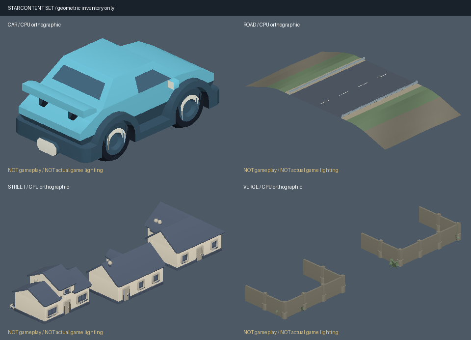

# 汐见海岸：完整一局的成套内容标准件

**🧪 可重建的接线候选，不是已采用画面。** 本批把完整车辆、道路与连续坡岸、同族街屋、围合植被做成四件标准，保留来源和动作身份。游戏源码、驾驶、相机、现有资产和 `quality.md` 均不变；接线与实际追尾画面的判断由案例线完成。

## 一页风格说明

**用统一的低模海岸街区重述公路竞速的空间关系，不用免费低模包冒充地平线写实资源。** 当前整弯远景最显著的问题是道路像平整展示底座，岸边没有坡面接入海岸，建筑与植物重复、材料层次薄。先把“路—肩—坡岸”和“街屋—院落—围合”做成可组合结构，再判断灯光与密度；本批不扩大赛道或堆物件。

| 规则 | 本批固定规格 |
|---|---|
| 形状语言 | Kenney 完整刚体源；保留车灯、轮拱、窗、屋檐、门廊与围栏；建筑不强拉成连排墙。车为封闭座舱，不另加看不见的驾驶员。 |
| 比例与坐标 | 米、右手系、+Y 上、+X 车头／路向、+Z 横向。车 3.315×1.430×1.690m；住宅统一 6 倍源尺寸，最高约 5.001m；围栏高约 1.08m。原点、足底、轮轴与各件完整包围盒在 manifest。 |
| 六个主色 | 车漆青 `#69b9ce`、墙面暖白 `#e1d8c4`、屋顶灰蓝 `#596577`、植被灰绿 `#71876a`、路面蓝灰 `#535b67`、岸坡灰褐 `#827e70`。玻璃／轮胎更暗，标线与金属仅作小面积亮点；不是让整屏一起提亮。 |
| 材质族 | 11 个语义族共享色板和线性 sRGB 顶点色。原图集按面选材质族、保明度变化，车窗的原浅蓝图集单元固定映射到玻璃；Suburban 绿色屋面归屋顶。PBR roughness 只随 GLB 留元数据，现消费者仍是 Lambert／Toon，不承诺车漆清漆反射。 |
| 地面连续性 | 道路源保持 16m 沥青宽、24m 长；既有路肩外接渐降剖面，到横向 ±22m 时约低 2.9m。两端剖面一致，路面底网与坡岸长向细分不超过 2m（标线3m、护栏面板6m），供一次性样条映射；不是垂直裙边或整体底盘。 |
| 纹理与细节 | 运行标准件零纹理；原图集保存在 `source/`。颜色烘焙对本批重映射后的基准层双线性采样检查每面 15 点，阈值 4/255；不等价于原图颜色、mipmap 或纹理材质。没有虚构纹素密度；几何细节按本表米制控制。 |
| 机位与光照 | 正常追尾车宽占屏 17–22% 是**待实机核对的设计目标**，不是已量得的参照结果。用原游戏命名机位、同状态、原光照验阵容；CPU 目录图只检查轮廓／朝向，整弯远景不替代近景或手感。 |
| 加载预算 | 四件原始 GLB 总计不超过 1,500,000B；每件预算与实数在下表。按片段一次加载、解析和缓存，不在帧循环重建。当前适配共 25 个独立 Mesh；不是已测屏内 GPU draw calls／手机帧时。 |

地平线官方强调地貌、植被、雾与动态光照一致，并把发动机录音作为车辆身份的一部分。本作保留这种“路属于环境、视听共同反馈”的目标，资源精度、光照反射与真实操控仍有明显差距。来源：[Forza 官方七月开发说明](https://forza.net/news/forza-horizon-5-road-to-mexico-july-update)，2026-10-27 核原文；未把该文章当作已看完一场实机比赛。

## 完整一局：类别不省略，数量先缩小

| 一局阶段／类别 | 现有入口与本批内容 | 仍需接续的实际缺口 |
|---|---|---|
| 菜单／选赛道 | 现有 course-art、开局与设置界面 | 窄屏层级和返回流程随真实一局复验；不新增菜单美术。 |
| 玩家车辆／角色 | 原 `racer.js` 车与驾驶员仍默认；本批完整 sedan-sports，车身含扰流板＋四个独立轮 | 主车遮挡、近景识别、旧涂装与物理视觉匹配。封闭座舱无独立人物动作。 |
| 对手／幽灵 | 原 `race-features.js` 的对手与幽灵继续 | 不盲换对手；接线后再核颜色／透明度可读性。 |
| 场景地表／道路 | `road.glb`：道路、路肩、分级岸坡、标线、两侧护栏标准段 | 沿原样条放置、临近赛段岸坡裁切、与既有海平面／地形交接；不能直接整圈复制而产生重叠。 |
| 建筑／地标 | `street.glb`：同族 A/G/M 三屋，有前后错位 | 门朝 −Z；沿道路摆放时朝路，地标仍用原场景。不把住宅冒充商店或可进入建筑。 |
| 围合／植被 | `verge.glb`：两组原围栏与六簇 Nature 植物，保留通行开口 | 按院落与路肩布置；大树冠层、连续远山仍缺，本批不挪旧樱树。 |
| 天空／光照 | 原 Kenney 全景、原半球光与方向光、原色调映射 | 全景不是环境反射；HDRI／阴影／空气透视的正式接线不在此批。 |
| 材质 | 全批色板与语义族；原图集留作再次编辑的来源 | 当前 `render-three.js` 无 UV／PBR 材质入口；不能把标准 GLB 的粗糙度写成运行效果。 |
| 动作 | 四轮滚动、前轮转向、车身侧倾与轻微升沉；接原 `roadSteer`／`wheelSpin` | 制动、侧滑与碰撞恢复要在普通输入下看；没有骨骼动画或损坏变形。 |
| 特效 | 原刹车／漂移／比赛提示继续，旧喷射不作为公路目标 | 轮胎接地点、尘土与轻擦反馈需同帧视听观察，不为填表新增粒子。 |
| 引擎声 | 现有程序引擎与 driving-audio 候选 | 油门／转速／松油的真实混合听验，候选不能自动采用。 |
| 轮胎声 | 现有胎噪／滑移事件 | 同弯抓地到侧滑的连续性及声画同步。 |
| 碰撞声 | 已有 CC0 rail impact 与程序回退 | 轻擦／重撞层级及恢复后的声音复位。 |
| 环境声／比赛提示 | 现有音乐、环境候选、倒计时／结算提示 | 启动—驾驶—结算混合层级；本批没有生成或试听新声音。 |
| HUD／结算／再玩 | 原计时、名次、圈数与本机记录／重试 | 完整跑圈、结算、再玩和返回菜单仍按案例线验收。 |

## 四件实际产物与身份

入口是 [`asset-pipeline/content-set/`](../asset-pipeline/content-set/)。`outputs/base/manifest.json` 固定每件最终 SHA-256、原源 SHA-256、尺寸、原点、部件、材质族与预算；`sources.json` 固定官方 ZIP／成员身份。**不是复用旧 `10f5f90` 上传，也没有读写旧壁画。**

| 标准件 | 实际三角形 | 原始 GLB 字节 | 每件预算（三角形／字节） | 动作／放置合同 |
|---|---:|---:|---:|---|
| [car.glb](../asset-pipeline/content-set/outputs/base/car.glb) | 2,075 | 262,684 | 3,000／450,000 | `body`＋四轮；车头 +X。轮轴在源归一后 ±0.858m，轮半径约 0.39m；**不等同于原车 ±1.02/1.06m 轴位**，不能改碰撞体迁就候选。 |
| [road.glb](../asset-pipeline/content-set/outputs/base/road.glb) | 2,202 | 276,056 | 3,000／450,000 | 长向24m，沥青16m，连岸44m；道路＋坡肩一个 Mesh，护栏8个复用源实例。静态、不参与模拟。 |
| [street.glb](../asset-pipeline/content-set/outputs/base/street.glb) | 3,317 | 405,016 | 5,000／700,000 | 三栋同族独立 Mesh，组宽约28.184m；足底 y=0，门朝−Z，不拉伸房屋。 |
| [verge.glb](../asset-pipeline/content-set/outputs/base/verge.glb) | 1,192 | 150,500 | 2,000／300,000 | 约14.9m宽的围合＋低灌木；静态，非碰撞边界。 |

删掉的仅为源中精确零面积三角：车13面、街屋合计36面；其他面保绕序，源法线经逆转置归一。道路重映射、细分及岸坡新增是明确的程序改作，不把它们称作未经改动的 Kenney 模型。源材质的双面标记改为标准件单面，已核外向绕序；真实背面可见性仍需接线检查。



## 重建、二改与接线

```sh
cd asset-pipeline/content-set
npm ci --ignore-scripts
python3 build.py
python3 build.py --recipe recipe-warm.json --out outputs/warm
node validate.mjs
node --test tests/consumer.test.mjs
python3 -m unittest discover -s tests -p 'test_*.py'
```

Python 需要 Pillow；Node 工具锁定 Three `0.186.0` 和 Khronos `gltf-validator` `2.0.0-dev.3.10`。`preview.py` 另需 NumPy，只生成标注为 CPU 的目录图，不是运行前置。源缺失、hash 漂移、颜色误差超门或超预算都会失败，不自动更新源哈希。两份 recipe 的唯一视觉变更是整批 RGB gain `1,1,1` → `1.05,.98,.93`；四件颜色／hash 都变，位置、法线、索引与轴心保持逐字节相同。重建与缺件／坏输入回归见内部测试。

[`adapter.mjs`](../asset-pipeline/content-set/adapter.mjs) 是**供案例线接线的离线／加载时适配**，没有导入到游戏：

1. 成功加载并核 manifest SHA 后，`decodeStandardPart(bytes)` 只读本批 Float32 POSITION／NORMAL／COLOR_0 和 Uint32 indices。拒绝不支持的贴图、动画、骨骼与未知布局；输出 `sourceData` **stride 10**（位置3、法线3、色3、旧 gloss1）和 `sourceIndices`。
2. 把原 `Mesh`、`Node`、`translation` 传入 `instantiateForStar(parts, api)`，得到根节点和明确名字的 `byName`，不靠 `userData.part` 猜身份。每个部件合并材质 primitive，避免把每个色块变成额外运行时 Mesh；保留旧 gloss=0.12，Three 当前不消费它。
3. 车辆 `poseCar(instance, {steer: player.roadSteer, wheelSpin, roll, bob}, api)` 使用原 `mm/ry/rz/trs`：四轮绕 Z 滚动，只有前轮绕 Y 转向；车身含扰流板一起侧倾／升沉。保留原模拟状态；加载失败继续原车，不先删旧车。外观轴距与原物理轴距差异必须实机决定，不能声称“直接替换完全等价”。
4. 道路 `bendRoadParts(parts, circuitRoad, centerS)` 其中 `centerS` 是段中心站位，覆盖 `[centerS−12, centerS+12]`，连续段中心间隔24m（若持有段起点，传起点＋12）。只在 chunk 创建时把标准段映射到原曲线帧；路面按曲率／坡度变换法线，护栏用相邻曲线端点间的6m刚性弦段，避免细长顶面逐顶点弯曲后翻面，面板中心线端点衔接；宽0.13m端面仍可能有小接头缝，不冒称整截面无缝；检查实际三角绕序／面积，局部折叠或坏帧就拒绝。还需原道路邻段距离裁切外岸和海面交接；函数不提供地形布尔或碰撞。房组与围合仍以刚体变换摆放，不弯曲屋檐。
5. 加载取消、换赛道迟到回调、旧件回退和缓存释放由案例线原生命周期接入；`dispose()` 清空自己的子树、解绑节点 Mesh 并幂等释放；调用方先从父树及缓存提交列表移除本批，不得继续提交旧 Mesh，否则原渲染器会重建其几何。当前仅测试其真实 CPU 释放路径，未声称异步网络生命周期已经接好。

## 已验证与停止线

- 八个最终 GLB（base＋warm）：Khronos 官方 Validator 全部 **0 errors／0 warnings／0 infos**。使用 Float32 NORMAL 和 COLOR_0、所有 view 4 字节对齐；不使用量化扩展，避免“Three 能载但规范不合法”。逐件报告在各输出目录的 `gltf-validation.json`。
- 真实 Three GLTFLoader、**原** engine Mesh 与 **原** render-three 几何函数的 CPU 消费；前后轮动作、材质数据、尺寸、坡岸接缝、样条适配与释放验证通过。这里只执行原几何函数，不创建 WebGLRenderer。
- 本批 Node 消费与异常路径16项、Python源重建／失败路径6项通过。公开扫描零发现；全仓文档检查仍有原 base 的 `assets/impact-audio/candidates/synth-v1/SOURCE-README.md:49` 缺 `browser-decode-check.json`，本批41个新增文件无文档／JSON错误，未越界修改旧音频。
- 两版从源重建逐字节一致；二改覆盖四件。源／CPU／规范检查不是新车已接入、图形质量采用或性能结论。
- **未验证**：实际游戏接线、普通追尾／完整一局、同机位前后比较、硬件 GPU 帧时、混合音频及操控品质。阵容图须在本作光照与普通机位下获得，原任务保持候选，不标 accepted，不推默认分支或 Site。

### 来源与探索取舍

2026-10-27 核官方页及实际原包：Kenney [Car Kit 3.1](https://kenney.nl/assets/car-kit)、[Racing Kit](https://kenney.nl/assets/racing-kit)、[City Kit (Suburban) 2.0](https://kenney.nl/assets/city-kit-suburban)，均为 CC0。Racing 官方网页更新栏标1.0，实际 ZIP 许可标2.0；两者不一致，以 `sources.json` 的 ZIP SHA 固定身份，不推断哪项版本号正确。Nature 2.1 使用正式 base 已固定的原 OBJ 归一副本，原始与归一哈希分开记录。优先复用已取得的 Suburban／Nature，车辆与道路缺件从官方补取；未付费、未用生成权重、无新账户。包内许可逐件留存于 `source/`，仅规范 LF／尾空白，词句不改；原许可成员和规范副本的哈希分开记录。

探索回执：读取当前 a1 地图与成套内容／质量／前沿 Skill、正式案例源码、官方来源与 [Khronos Validator 实现](https://github.com/KhronosGroup/glTF-Validator)、[glTF 2.0 规范](https://registry.khronos.org/glTF/specs/2.0/glTF-2.0.html)；采用已有同作者低模套件＋小型程序岸坡，避免引入新的全场资产栈。本轮不是资产市场排行；未取得新的中文社区同题比较或完整标杆实机，最高写实质量未知。相比只交 PBR GLB，本批增量是**可重建身份、规范门及当前 vertex-color 消费合同**。
