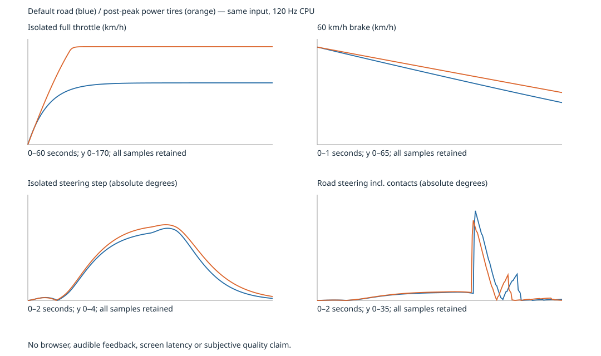
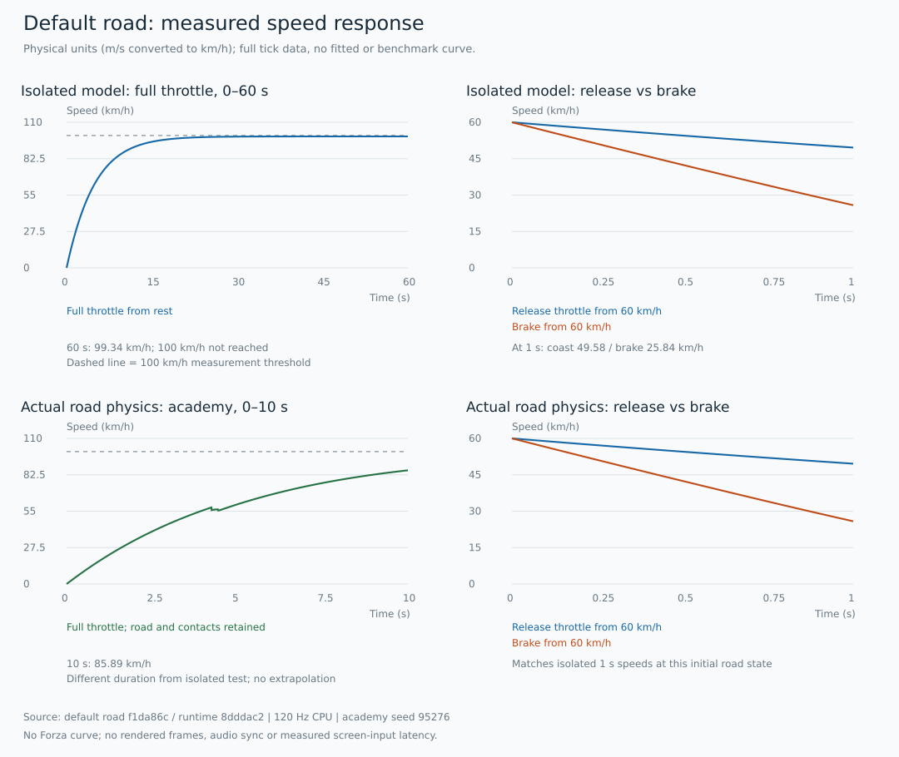
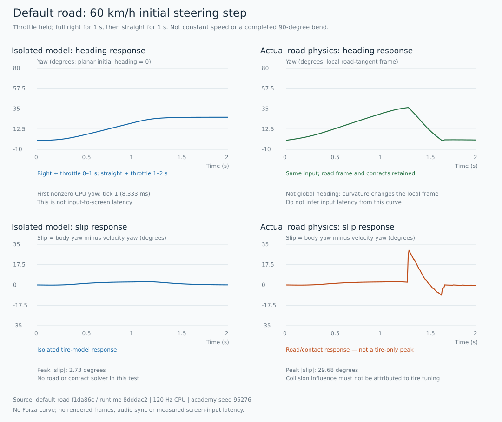

# 当前旁置手感：动力与峰后轮胎

当前整合以 `ab69388d` 为默认基线，选用保全的 `1bbf606a` 峰后二改；不修改默认驾驶。完整同输入默认轨迹与基线逐字节一致，SHA-256 `d322366e68ac8e3b2efc3223b6e889fdecdf2746f65a2b20f4cc824934f77cb0`。



同一 `tests/fixtures/feel-inputs.json`、120 Hz；原始摘要与压缩逐 tick 日志在 `quality/side-release/`。隔离平地0–100：默认60秒未到，候选6.258333秒；60 km/h松油1秒49.578885→58.604467 km/h，制动25.841689→32.022143 km/h；隔离转向侧滑峰2.729140→2.863617°。真实训练场0–100候选6.575秒，侧滑峰29.676115→26.495853°（含道路/护栏，不归因纯轮胎）。制动更长不等于全面更好。

6路 assembled-client CPU输入各600步：默认、空间、轮胎、组合及空间/轮胎初始化故障；空间不改模拟，两个故障均退回默认且轨迹相同。三赛道轮胎自动驾驶完赛118.8500/191.3167/42.0333秒；比赛41475个机器人载荷样本有限、非负、和为mg。不冒称所有机器人同时完赛或实际人感达标。浏览器与发布结论统一见 [记分卡](quality.md)。

复测命令：`node tests/feel-measure.mjs outputs/before`，`node tests/feel-measure.mjs outputs/after --power-tires`，`node tests/feel-compare.mjs outputs/before outputs/after docs/quality/side-release`。首次目录须不存在。默认对照须使用固定默认源及同脚本/fixture，不能以false对false自比替代。

---

# 默认公路驾驶：手感规格与 CPU 首测

基线 `f1da86c`（运行源 `8dddac2`），120 Hz，默认 `/` 与 `/road` 的同一模型；**不包含 `/rapier` 旁置**。本表依据 a1dbv `f4b4e801` 的 quality-bar 与 feel：地平线没有可直接套用的公开调校数值，尚无已逐帧测量的标杆录像，故范围和 ±20% 对照待建立，不能判达标。

## 管线和模型核对

| 项 | 实际源路径与行为 | 缺口 |
|---|---|---|
| 模拟／插值 | `race.js` FIXED_STEP=1/120；rAF 累加，最多12步，超预算丢余量；`sceneFrame` 按 accumulator 对 prevPose/current 插值 | 不是任意卡顿下无损时间推进；60/144Hz屏幕平滑未实测 |
| 追尾相机 | `sceneFrame` 每渲染帧更新，方向指数阻尼8/s，位置18/s；使用插值位置但速度/velocityYaw来自最新模拟 tick | 不仅在physics中更新，也不是原始鼠标视角；没有自由鼠标追尾视角，不套FPS Pointer Lock指标 |
| 输入 | 真实physics消费input/assistedSteer；键盘与触屏更新状态；旧漂移/喷射有edge buffer | 普通转向/油门没有完整带序号tick的边沿命令日志；CPU fixture不证明极短DOM按键不丢 |
| 动力与阻力 | `road-vehicle-core.js` drive上限5.5m/s²，制动7.5m/s²；阻力`.18*u+.0007*u*abs(u)`；cruise32.5m/s是动力目标 | 配置不是实际加速度/最高速；无挡位/发动机扭矩曲线 |
| 转向 | 最大转角 min(.50,atan(.85*10.5*2.08/max(16,u²)))；转向slew=3×limit/s，松开/反向5×limit/s | 原创键盘方案，尚无地平线录像对照 |
| 轮胎/载荷 | 前后轴线性侧偏力，抓地圆饱和，纵横共享预算；静态轴荷按轴距；独立车体角速度 | **无峰后下降轮胎曲线、纵向轮速滑移、前后/左右动态载荷转移**，不可称完整轮胎模型 |
| 辅助/漂移 | 自动油门、自动试驾、输入灵敏度存在；slip>0.08rad且u>5为drifting标识 | 无独立可切TCS/ESC/ABS/反打辅助；无公路手刹输入；Shift不进入公路漂移，旧喷射不算当前目标 |
| 速度与视听 | 相机lead跟速度；FOV公式只加boostBlend×3，公路喷射停用；引擎/轮胎/碰撞已有声音路径 | 普通速度FOV变化未实现；没有音画镜头同帧证据 |

## 可复现实测

执行 `node tests/feel-measure.mjs outputs/<新目录>`（先安装根与 `experiments/rapier-road-comparison` 锁定依赖；导入既有 build.mjs 会构建静态产物，不启动浏览器）。fixture 在 `tests/fixtures/feel-inputs.json`，每tick保留输入、位置、速度、yaw、spin、轮角、侧滑角和漂移状态。日志在输出目录 `ticks.jsonl`，汇总及源文件SHA-256在 `summary.json`。摘要存档见 [首测 JSON](quality/feel-baseline/summary.json)。两次独立进程完整逐tick日志与摘要逐字节一致；这不是跨平台确定性保证。

- `model-*` 直接调用正式 RoadVehicleModel.step，不复制方程、不固定速度、不改参数；无道路/坡度/碰撞的隔离平面响应。初始60km/h是显式fixture状态，不是油门加速成绩。
- `client-*` 调用真实 assembled client 的 `physics`，训练场 practice，关闭自动油门/试驾，灵敏度1，初始s=0；真实道路积分、护栏接触保留。绘图为stub，不产生任何屏幕帧证据。
- 转弯使用可重复的 **60km/h初始、满右+油门1秒、回正+油门1秒** 作为等价输入阶跃，既非恒速圆周也非完成90°弯；不把接触后的滑移当纯轮胎响应。道路坐标yaw会受曲率变换，不能直接把client首个yaw变化当转向延迟。

| 项 | 本作源参数／取值理由 | 隔离模型实测 | 真实训练场physics实测 | 标杆值／来源 |
|---|---|---|---|---|
| 0–100km/h | drive≤5.5，cruise32.5；沿用原创基线不调参 | 60秒未达到；60秒99.3395km/h | 10秒85.8853km/h，含道路接触；未达100 | 待从官方Emerald Circuit对应车辆录像逐帧测量 |
| 60km/h松油1秒 | 上述线性+二次阻力 | 49.5789km/h；均值减速度2.8948m/s² | 49.5789km/h | 待核，无公开标定值 |
| 60km/h制动1秒 | 制动力与抓地预算共同作用 | 25.8417km/h；均值减速度9.4884m/s² | 25.8417km/h | 待核，不能把7.5配置冒称总减速度 |
| 转向输入到车头变化 | 速度相关slew，无屏幕量测 | 首physics tick（8.333ms），阈值abs(yaw)>1e-9 | 道路坐标首tick变化不具有屏幕延迟意义 | 待核屏幕帧；CPU tick不等于输入到可见反馈 |
| 转向/回正侧滑峰值 | 上述2秒输入阶跃 | 2.7291°；漂移标识0秒；末速72.4211km/h | 29.6761°；漂移标识0.2417秒；末速54.8481km/h，含接触 | 待录像同动作对照 |
| 反打响应 | 右+油门1秒、左+油门0.5秒、回正+油门1秒 | 峰值侧滑2.7291°；漂移标识0秒，末速75.1489km/h | 本轮未做道路反打独立场景 | 待核 |
| 碰撞恢复/声音镜头 | 原有接触、spin与声音调用 | 本轮不设恢复达标范围 | 转向场景含护栏影响，但不替代专门轻擦恢复测量 | 待同输入录像/音轨 |

## 首测曲线：只画本作，不补虚构标杆



上排是正式模型隔离平面响应，下排是真实训练场physics（道路积分与接触保留）。速度是模拟米/秒×3.6的物理尺度，不是屏幕像素。全油观察窗分别为60秒与10秒，不能横跨不同时间轴比较加速成绩；100km/h虚线只是测量门槛，不是标杆曲线。末端99.34km/h与1秒松油49.58/制动25.84km/h均来自原始日志。



四图使用同一初始60km/h输入阶跃（满右+油门1秒，回正+油门1秒）。左侧为隔离平面角度，右侧yaw相对道路切线而非世界固定朝向；右侧29.68°侧滑峰值包含护栏接触，不可当轮胎模型自身峰值。曲线未渲染游戏画面，不提供屏幕输入延迟、声音/镜头同帧或恒速90°弯成绩。

确定性重建（从仓库根执行；输出SVG工具只用Node内置模块）：

```sh
node tests/feel-measure.mjs outputs/feel-chart-source
node tests/feel-charts.mjs outputs/feel-chart-source docs/quality/feel-baseline
```

每个SVG的`metadata`保留完整fixture、120Hz、源文件SHA-256、原始ticks/summary哈希与训练场`routeSeed=95276`（来自`race.js`固定赛道reset；隔离模型不使用随机数）。工具先核源码哈希、逐tick连续性和坐标范围，全部采样点进路径，不平滑/拟合/删去接触峰；同一输入日志重复生成字节一致。它不取代仍等待的真实机位与GPU基线。

上述默认基线的手感模型差距是静态饱和轮胎与缺失载荷转移；最大的验收缺口是没有标杆同动作录像、屏幕输入延迟和三路反馈同帧记录。下一项先把60km/h输入阶跃接到既有拍摄模式并获取本作/参照同动作证据，再决定是否改轮胎层；不以本轮CPU数字盲调到未知标杆。

## 旁置动力与载荷候选：power-tires-v1

入口 `/?handling=power-tires-v1`（`/road?handling=power-tires-v1` 等价）。默认仍 road-v2；ac246初版使用 road-v3；峰后二改使用 road-v4 隔离本机成绩/幽灵/设置，默认 road-v2 与旧 road-v3 都不迁移不覆盖。HUD 标记 POWER-TIRES V1。机器人与玩家调用同一候选 RoadVehicleModel；机器人仍保留旧保守选线/目标速度，不把本轮当 AI 提速或漂移完成。

**量级参照**：轻型后驱公路跑车，而非超跑。[Toyota 官方 GR86 发布数据](https://global.toyota/en/newsroom/toyota/34997138.html)给出0–100 km/h **6.3秒**。只借这个公开性能量级，选6.3±20%（5.04–7.56秒）作为隔离平地首项门槛；不复制品牌车、发动机曲线、商业游戏调校，也不称地平线已对照。质量标准中的标杆录像、屏幕输入响应及音画反馈仍未验证。

**先改模型再调数值**：旧版把0.18×速度的一阶阻力和二阶气阻一同施于后轴；在100 km/h仅一阶项就消耗5 m/s²，接近整个后轴静态抓地预算，导致标称cruise 117 km/h但实际99.34 km/h。候选保留220有效质量/245偏航惯量和原车轴距（这是缩放后的游戏车体，不是真实GR86质量），动力上限4.8 m/s²，速度目标45 m/s，速度阻力改为0.012u+0.0007u|u|。这是原创轻量动力曲线，不含挡位/轮速滑移。

上一真实积分步的车身纵/横向受力加速度驱动下一步准静态轮载：前后转移 m·ax·h/L，左右转移 m·ay·h/track，h=0.45 m、track=1.5 m为本作假设。四轮载荷非负且和为mg；极端转移按轴可用载荷限制，不模拟腾空/悬挂。各轮抓地用归一化载荷的0.9次幂，相同轴荷偏到外轮会降低总抓地，前后轴纵横力仍共享抓地圆。实际力而非油门请求反馈，不把旋转坐标的r·v项当物理载荷。原版分支逐tick数学保持。

同一 `tests/fixtures/feel-inputs.json`，同一 `tests/feel-measure.mjs`，只加 `--power-tires` 切候选。前后各记录每tick，候选双进程逐字节一致；日志和摘要见 [power-tires-v1](quality/power-tires-v1/)。这是CPU轨迹，不是屏幕帧。

| 同一输入 | 默认基线 | 旁置候选 | 边界 |
|---|---:|---:|---|
| 隔离平地0–100 km/h | 60秒未到，末99.3395 | **6.2583秒** | 落在所选量级；未有换挡/轮速模型 |
| 真实训练场全油0–100 | 10秒未到，末85.8853 | **6.6083秒**，10秒143.6886 | 原道路/护栏保留，不冒充无接触直道成绩 |
| 60 km/h松油1秒末速 | 49.5789 | **58.6045 km/h** | 修掉旧强阻力；未有标杆松油录像 |
| 60 km/h制动1秒末速 | 25.8417 | **32.0221 km/h** | 旧阻力此前帮助减速，候选制动更长，不称全面更好 |
| 隔离满右/回正侧滑峰 | 2.7291° | **2.9296°** | 原2秒阶跃，不是漂移达标 |
| 真实训练场同阶跃侧滑峰 | 29.6761° | **28.0553°** | 含道路接触，不能归因纯轮胎 |

当前最大剩余手感差距：制动距离/入弯可控性和真实逐帧反馈尚待比较；ac246初版尚未包含峰后下降，二改见下节；两者都不是TCS/ABS或悬挂。暂不扩漂移系统，不改默认驾驶；浏览器smoke与非作者手感判优分别验收。

### 同单元二改：轮胎峰后下降（CPU 候选）

先定测法再比较：动力取**隔离平地模型**，静止、方向归零、无制动、持续全油，固定120 Hz，以首个速度≥100/3.6 m/s的tick记0–100；最多60秒，没到就记未达；240 Hz仅核步长敏感性。6.3秒取上述 Toyota 公布量级，**5.04–7.56秒是本项目自定±20%容差**，理由是只做轻型公路跑车量级而非拟合真实动力总成；不是标杆实测范围。实际训练场含弯道/护栏，单列，不拿它调平地门槛。

峰后曲线先采用游戏设计假设：静态轮载下每轴约8–9°到峰，大侧滑渐近峰值的78%；这些不是轮胎试验或地平线测得参数。保留原小角度刚度（前轴m×55、后轴m×60），峰值受原载荷敏感抓地预算控制，峰值角为capacity/stiffness×π/2。峰前正弦段、峰后高斯衰减段在峰处值及斜率连续，左右奇对称；只减少滑动侧向力，不添漂移奖励、额外推力或新的操作。原纵横抓地圆仍限制合力，原载荷转移保留。默认分支不启用此曲线。

同一 `tests/tire-curve-measure.mjs` 对二改前ac246模型和当前模型分别逐点调用实际 `RoadVehicleModel.step`：前向20m/s，初始横速20×tan(侧滑角)，静态初载荷，零油/零刹/零转向，每0.25°采样0–60°，每点独立一步。它测模型力曲线，不是完整过弯轨迹；峰角精度受采样间距限制。[原始曲线和源hash](quality/tire-falloff-v1/curve.json)。

| 同输入指标 | ac246载荷候选 | 峰后下降二改 |
|---|---:|---:|
| 侧向合力曲线 | 约2310N饱和平台，0–60°未出现峰后下降 | 采样峰8.5°／2304.4457N |
| 30°侧向力／采样最大值 | 99.9948% | 78.1919% |
| 60°侧向力 | 2309.9597N | 1801.8000N |
| 平地0–100，120Hz | 6.2583s | 6.2583s |
| 平地0–100，240Hz | 6.2583s | 6.2583s |

四轮载荷非负与总和mg、默认精确轨迹、正常弯道与极限混合输入另由CPU测试接收。浏览器、实际逐帧反馈、声音和驾驶判优尚未验证；这些模型数值不表示漂移/手感达标。

CPU道路接收：同一候选自动驾驶三赛道均完赛（coast 118.8500s、sakura 191.3167s、academy 42.0333s）；coast比赛玩家115.2083s完赛、非DNF，机器人最高27.1828m/s。比赛中41,475次机器人载荷样本有限、非负、总和mg；玩家结束时三个机器人finishAt仍为空，不称已验所有机器人完赛。正常45/55/65km/h转弯释放恢复及极端侧速/自旋组合已过CPU断言；不能代替真实操作、离轨恢复品质或新旧手感判优。
