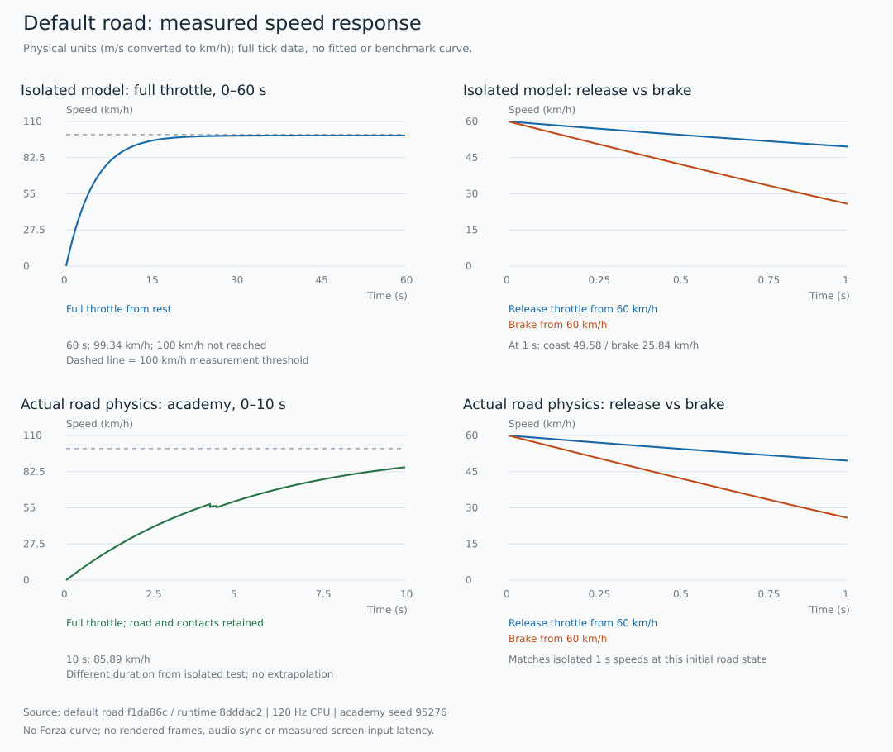
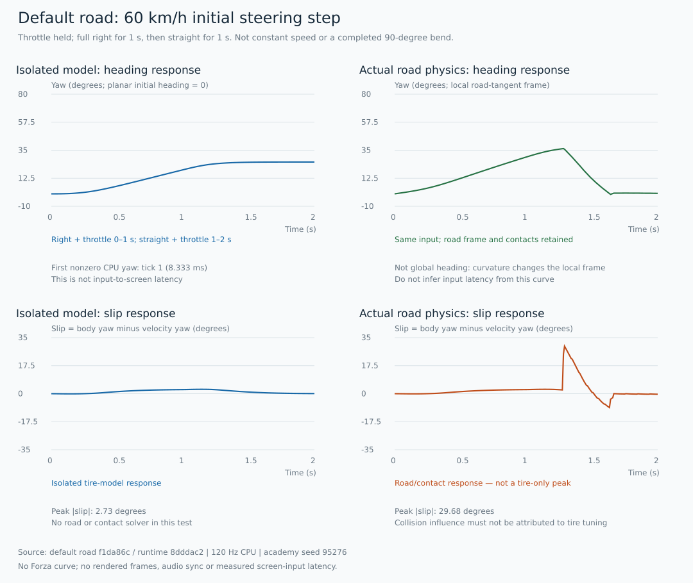

# 默认公路驾驶：手感规格与 CPU 首测

基线 `f1da86c`（运行源 `8dddac2`），120 Hz，默认 `/` 与 `/road` 的同一模型；**不包含 `/rapier` 旁置**。本表依据 a1dbv `f4b4e801` 的 quality-bar 与 feel：地平线没有可直接套用的公开调校数值，尚无已逐帧测量的标杆录像，故范围和 ±20% 对照待建立，不能判达标。

## 管线和模型核对

| 项 | 实际源路径与行为 | 缺口 |
|---|---|---|
| 模拟／插值 | `race.js` FIXED_STEP=1/120；rAF 累加，最多12步，超预算丢余量；`sceneFrame` 按 accumulator 对 prevPose/current 插值 | 不是任意卡顿下无损时间推进；60/144Hz屏幕平滑未实测 |
| 追尾相机 | `sceneFrame` 每渲染帧更新，方向指数阻尼8/s，位置18/s；使用插值位置但速度/velocityYaw来自最新模拟 tick | 不仅在physics中更新，也不是原始鼠标视角；没有自由鼠标追尾视角，不套FPS Pointer Lock指标 |
| 输入 | 真实physics消费input/assistedSteer；键盘与触屏更新状态；旧漂移/喷射有edge buffer | 普通转向/油门没有完整带序号tick的边沿命令日志；CPU fixture不证明极短DOM按键不丢 |
| 动力与阻力 | `road-vehicle-core.js` drive上限5.5m/s²，制动7.5m/s²；阻力`.18*u+.0007*u*abs(u)`；cruise32.5m/s是动力目标 | 配置不是实际加速度/最高速；无挡位/发动机扭矩曲线 |
| 转向 | 最大转角 min(.50,atan(.85*10.5*2.08/max(16,u²)))；转向slew=3×limit/s，松开/反向5×limit/s | 原创键盘方案，尚无地平线录像对照 |
| 轮胎/载荷 | 前后轴线性侧偏力，抓地圆饱和，纵横共享预算；静态轴荷按轴距；独立车体角速度 | **无峰后下降轮胎曲线、纵向轮速滑移、前后/左右动态载荷转移**，不可称完整轮胎模型 |
| 辅助/漂移 | 自动油门、自动试驾、输入灵敏度存在；slip>0.08rad且u>5为drifting标识 | 无独立可切TCS/ESC/ABS/反打辅助；无公路手刹输入；Shift不进入公路漂移，旧喷射不算当前目标 |
| 速度与视听 | 相机lead跟速度；FOV公式只加boostBlend×3，公路喷射停用；引擎/轮胎/碰撞已有声音路径 | 普通速度FOV变化未实现；没有音画镜头同帧证据 |

## 可复现实测

执行 `node tests/feel-measure.mjs outputs/<新目录>`（先安装根与 `experiments/rapier-road-comparison` 锁定依赖；导入既有 build.mjs 会构建静态产物，不启动浏览器）。fixture 在 `tests/fixtures/feel-inputs.json`，每tick保留输入、位置、速度、yaw、spin、轮角、侧滑角和漂移状态。日志在输出目录 `ticks.jsonl`，汇总及源文件SHA-256在 `summary.json`。摘要存档见 [首测 JSON](quality/feel-baseline/summary.json)。两次独立进程完整逐tick日志与摘要逐字节一致；这不是跨平台确定性保证。

- `model-*` 直接调用正式 RoadVehicleModel.step，不复制方程、不固定速度、不改参数；无道路/坡度/碰撞的隔离平面响应。初始60km/h是显式fixture状态，不是油门加速成绩。
- `client-*` 调用真实 assembled client 的 `physics`，训练场 practice，关闭自动油门/试驾，灵敏度1，初始s=0；真实道路积分、护栏接触保留。绘图为stub，不产生任何屏幕帧证据。
- 转弯使用可重复的 **60km/h初始、满右+油门1秒、回正+油门1秒** 作为等价输入阶跃，既非恒速圆周也非完成90°弯；不把接触后的滑移当纯轮胎响应。道路坐标yaw会受曲率变换，不能直接把client首个yaw变化当转向延迟。

| 项 | 本作源参数／取值理由 | 隔离模型实测 | 真实训练场physics实测 | 标杆值／来源 |
|---|---|---|---|---|
| 0–100km/h | drive≤5.5，cruise32.5；沿用原创基线不调参 | 60秒未达到；60秒99.3395km/h | 10秒85.8853km/h，含道路接触；未达100 | 待从官方Emerald Circuit对应车辆录像逐帧测量 |
| 60km/h松油1秒 | 上述线性+二次阻力 | 49.5789km/h；均值减速度2.8948m/s² | 49.5789km/h | 待核，无公开标定值 |
| 60km/h制动1秒 | 制动力与抓地预算共同作用 | 25.8417km/h；均值减速度9.4884m/s² | 25.8417km/h | 待核，不能把7.5配置冒称总减速度 |
| 转向输入到车头变化 | 速度相关slew，无屏幕量测 | 首physics tick（8.333ms），阈值abs(yaw)>1e-9 | 道路坐标首tick变化不具有屏幕延迟意义 | 待核屏幕帧；CPU tick不等于输入到可见反馈 |
| 转向/回正侧滑峰值 | 上述2秒输入阶跃 | 2.7291°；漂移标识0秒；末速72.4211km/h | 29.6761°；漂移标识0.2417秒；末速54.8481km/h，含接触 | 待录像同动作对照 |
| 反打响应 | 右+油门1秒、左+油门0.5秒、回正+油门1秒 | 峰值侧滑2.7291°；漂移标识0秒，末速75.1489km/h | 本轮未做道路反打独立场景 | 待核 |
| 碰撞恢复/声音镜头 | 原有接触、spin与声音调用 | 本轮不设恢复达标范围 | 转向场景含护栏影响，但不替代专门轻擦恢复测量 | 待同输入录像/音轨 |

## 首测曲线：只画本作，不补虚构标杆



上排是正式模型隔离平面响应，下排是真实训练场physics（道路积分与接触保留）。速度是模拟米/秒×3.6的物理尺度，不是屏幕像素。全油观察窗分别为60秒与10秒，不能横跨不同时间轴比较加速成绩；100km/h虚线只是测量门槛，不是标杆曲线。末端99.34km/h与1秒松油49.58/制动25.84km/h均来自原始日志。



四图使用同一初始60km/h输入阶跃（满右+油门1秒，回正+油门1秒）。左侧为隔离平面角度，右侧yaw相对道路切线而非世界固定朝向；右侧29.68°侧滑峰值包含护栏接触，不可当轮胎模型自身峰值。曲线未渲染游戏画面，不提供屏幕输入延迟、声音/镜头同帧或恒速90°弯成绩。

确定性重建（从仓库根执行；输出SVG工具只用Node内置模块）：

```sh
node tests/feel-measure.mjs outputs/feel-chart-source
node tests/feel-charts.mjs outputs/feel-chart-source docs/quality/feel-baseline
```

每个SVG的`metadata`保留完整fixture、120Hz、源文件SHA-256、原始ticks/summary哈希与训练场`routeSeed=95276`（来自`race.js`固定赛道reset；隔离模型不使用随机数）。工具先核源码哈希、逐tick连续性和坐标范围，全部采样点进路径，不平滑/拟合/删去接触峰；同一输入日志重复生成字节一致。它不取代仍等待的真实机位与GPU基线。

最大可定位的手感模型差距是静态饱和轮胎与缺失载荷转移；最大的验收缺口是没有标杆同动作录像、屏幕输入延迟和三路反馈同帧记录。下一项先把60km/h输入阶跃接到既有拍摄模式并获取本作/参照同动作证据，再决定是否改轮胎层；不以本轮CPU数字盲调到未知标杆。
