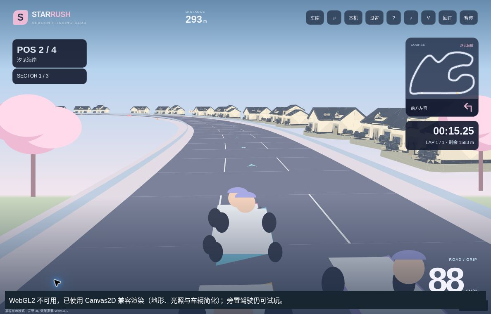
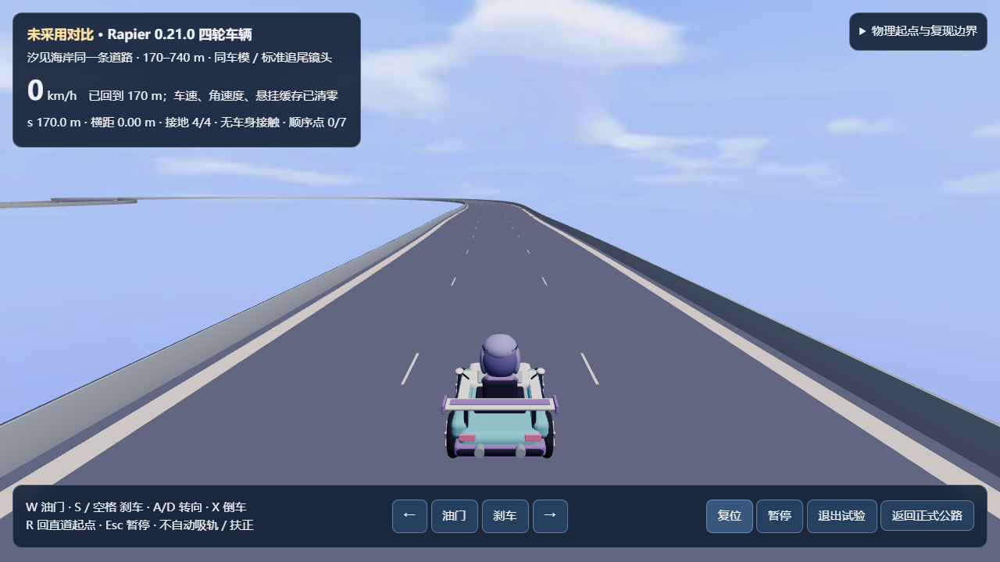
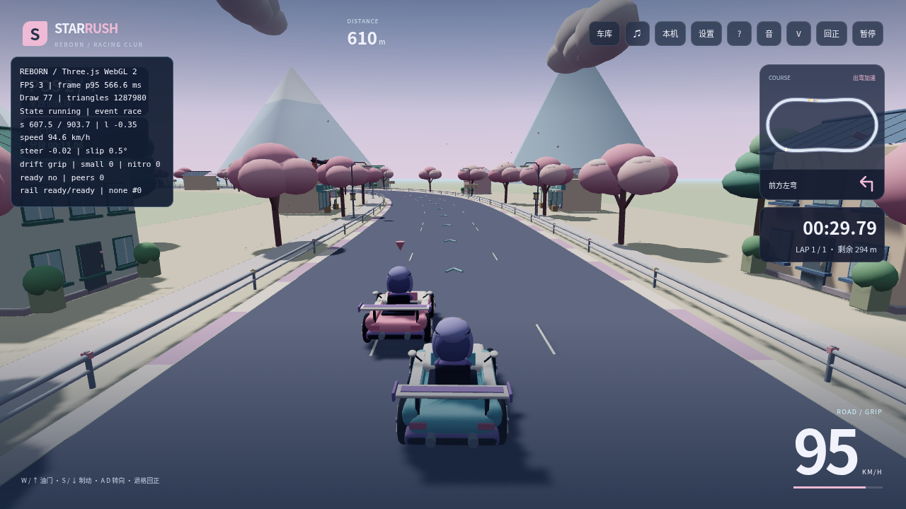

# 当前记分卡与旁置验收

## 当前阶段目标：海岸全弯至少一个机位 2→3

优先完成 `coast-full-bend` 的完整材料/内容层，让地表、路肩、暖灰墙面和低灌木形成一致的可读海岸场景。[目标 B 与 1–5 锚图](quality/targets/20261110/README.md)已经制作和非作者选图；它们是生成的设计参考，不是实拍、校准评分或前后对照，仍有机位/几何漂移。

本候选在既有 coast 开关内试接原 CC0 标准件中的六簇低灌木，单处 `s=340`；按完整地形单元、道路、街屋和已有布景的边界筛选。不整套硬塞围栏，不改模拟或默认入口。围栏已按当前地形整格支撑与全环旧布景保守净空筛选，40 个候选中 13 件接入同一 coast 开关，27 件拒绝；不移走旧物促成通过。源模型顶点、法线与矩阵原样用于真实 chunk，故障撤回及关闭开关零解码已作 CPU 验证。场景组织、真实落地观感和帧时仍未验，不计覆盖。来源、放置与未验项见[标准件消费](../assets/coast-verge/README.md)。

路肩已接入同一开关：原4m段起点300–708m的肩面改为沙灰`#c4b99f`、肩壁`#a59f89`，与地表和暖灰墙面同族；末段延至712m，不切几何。仅顶点色，不是新贴图，不改形状/光照/碰撞。关闭或失败恢复已缓存chunk的原色；独审确认Three几何/batch失效次序。CPU字节/回退测试不等于实际GPU/完整场景失败验收，机械重复、岸坡折面和光照仍待同机位评审。

住宅路边平台原先仍盖着旧浅绿底色，与已统一的地表/肩面割裂；现把同一目标段 300–712m 内、道路侧向 11–28m 的 206 个原平台四边形接到现有地形色场，外立面沿肩壁的灰褐色。平台每个原顶点按世界 XZ 读取所在 6m 地形三角的线性 RGB，不另调一套颜色；大平台面内部仍由原三角插值，不宣称与下方更细地形逐点相同。越界点保原色，缺源或非法色撤回全部本轮改色。位置、法线、索引、地形、房屋和道路均不变；这项只补颜色消费，未消除平台实体台阶。真实 GPU 下能否缓解底座感仍待同机位对比，不增加分数或覆盖。

墙面进一步按完整街段分为原暖灰、稍暖和稍冷三组，保留30栋与原矩阵/基础，只改变命名wall的RGB；不逐栋随机，不删除建筑制造空地。此项仅是缓解色彩重复的候选，不解决轮廓和间距重复；九种缓存网格上限及同机位取舍见[目标说明](quality/targets/20261110/README.md#unified-wall-family)。

真实硬件 GPU 同机位前后图、普通浏览器门槛、性能及双非作者盲评尚未通过。探索分仍 **2→2**，内容 **0/43**，网站未变。目标达成必须有实际图片和独立分数变化，不能以 CPU 测试计覆盖。

## 2026-11-06：同机位实拍与盲评已收到，尚未升档

两版各三机位双拍的 **12 张真实原图**已接收，比较器与逐拍退出收据通过。[完整前后图、SHA、双非作者原始评分和实现差量](quality/capture/B-STAR-QUALITY-CAPTURE-20261106/review/README.md)可复核。前版为已发布空间候选 `811646e8`，整层地形版为 `7e87d4c3`；两版都开空间、关轮胎，不能当默认入口的前后对比。

两位匿名独立评审都偏好整层版的全弯地表连续性，但三个机位的探索性完成度均 **2→2**，没有分数变化。该轮正式目标图及 1–5 锚图缺失；现已补生成参考（见当前目标），正式视觉分仍未建立，内容 **0/43（0%）** 不变。保留整层版作为下一轮起点，重点整层改善地块、海岸与远景衔接及机械重复；不以此宣布闭环完成或换默认。

这批图使用 Chrome 156.0.8078.4 / SwiftShader 软件 WebGL2，并非硬件 GPU。六条拍摄 Node 与 BrowserServer 均真实 exit 0，预览均关闭；外层接收调用退出仍未确认。候选四路正常浏览器最小门槛未由本次固定拍摄覆盖，候选实现尚未合入或部署。

## 2026-11-06：海岸街屋接入已有空间候选

`coast-space-v1` 的 320–680 m 连续街屋已接入真实场景：沿用已接收的三栋 CC0 标准件、原刚体矩阵和整排筛选，20 排中接收 10 排／30 栋，拒绝 10 排。新增独立基础并移除冲突旧布景；沿用空间、轮胎、Rapier 三个候选，默认入口不换。来源与运行接线见 [技术说明](coast-street-runtime.md)。

从父提交 `a9e8181` 验证：完整 npm test（188 项单测及客户端、三赛道、混合输入、API、构建变体）、构建、59 项作者测试、23 项专项测试通过；六路各 600 物理 tick 的状态 hash 与父版相同。非作者代码审查发现并修复了 Canvas 平滑法线误剔面和路肩盖住道路两项问题；修后 4,449 个道路覆盖采样及 7,107 个道路／街屋遮挡采样无错误。

准确冻结构建的真实浏览器最小门槛已通过：默认／空间／轮胎／组合分别从 0 推进到 **859／1824／859／1821** 个物理 tick，全部 Canvas2D，无应用源错误，开关与请求一致。使用正常菜单开局和真实 W 输入；静音，不含试听。已关闭自有标签，预览停止、启动会话 exit 0。[逐路收据](quality/street-side-20261106/browser-gates.json) 记录冻结构建 SHA-256；前两次被拦下的构建不计通过。

图为正常驾驶约 293 m 的实际兼容画面，只证明新街屋可见及本轮道路覆盖回归已修；不是命名机位、WebGL2、目标图或盲评。Canvas 仍简化地形、光照和车辆。三机位正式画面评分仍未建立，内容仍为 **0/43（0%）**；30 栋运行实例不计作 30 个品质通过项。完整比赛、同机位 WebGL2 对比、感知判断与目标硬件表现待验。

## 上次空间／轮胎旁置验收

| 线 | 已有改善／数据 | 最大剩余差距 |
|---|---|---|
| 画面 | 连续空间 `coast-space-v1` 复用保全空间层；默认地形不变 | 路肩黑边、建筑平台路径承接、岸坡机械折面；当前组合未做同机位图/盲评 |
| 手感 | `power-tires-v1` 峰后二改；同输入曲线见 [feel](feel.md)，平地0–100 6.258333秒 | 入弯制动距离、反打恢复与真实音画反馈仍待体验 |
| 内容 | 保留三条跑圈赛道、旧版入口与已交付Rapier短段 | 标准件成套接入未验，不增加新玩法或赛道 |

### 上次验收结论（旁置门槛通过）

基线 `ab69388d`；空间源 `40896953`/tree `37b83112`，轮胎源 `1bbf606a`/tree `e600812c`。选择性接入两项，保留已交付Rapier入口（沿用当前基线已接收的入口）；不恢复旧音频/材质任务。旧coast-flow与coast ambience非off构建候选已实际关闭；音频源、配方和待听资料保全。恢复需先完成待听判断并腾出候选名额，重新过旁置门槛。可访问未完整品质验收候选共三项：空间、轮胎、Rapier；空间＋轮胎是已有两项组合，不另算候选。

两档共用：开关关闭与固定默认源同输入回放一致；默认、空间、轮胎、组合四路需真实浏览器各推进至少600个120 Hz物理tick（不是600个rAF），无未捕获错误；WebGL2不可用可用Canvas2D，页面提示兼容状态。`window.starSideStatus`与右下可折叠“运行状态”的`#side-diagnostics-state`只读回报ticks/backend/开关/警告；无模拟修改接口。空间构造失败清除本次地形/装饰后退默认场景；轮胎预初始化失败在真实游戏/存档选择前退默认；渲染器初始化抛错也退Canvas。故障后提示明确，不靠吞错误假装候选成功。

空间为表现档，单测/构建；轮胎为模拟档，另加无画面三赛道整局及同输入前后曲线。单元171项、完整npm test消费者/默认三赛道/API/构建变体通过；中途空间回退修复后17项相关回归与生产构建通过。CPU已有6路×600步（含两个注入故障）及默认逐tick hash一致；数值、脚本与轨迹见 [feel](feel.md) 与 [CPU门槛数据](quality/side-release/client-gates.json)。准确构建的最小浏览器门槛已通过，可旁置发布；这不是完整比赛或品质判优。完整整局smoke、同机位图、盲评与听玩只卡换默认；本次默认驾驶和美术不换。

原上传调用结果仍未知；本次是新默认基线上的独立整合，不重复原上传。本轮云端原生浏览器使用同一 context 的新标签、正常菜单新比赛及真实 W 输入；四路从0分别推进867／839／837／839物理tick，开关与请求一致，均为 Canvas2D、非空画面，应用源错误为空。无继续存档提示，未清理原有存储。天然 WebGL2 不可用时提示兼容回退；静音验收，不含试听。14个静态文件与冻结构建逐SHA-256一致，game.js 为 `67d6ef012104b06cd5e9152918f61a080e7d7c988d16ee874e4297090cc21184`。旧版菜单正常；Rapier入口仍在，但当前浏览器 WebGL2 未就绪，明确停止而未冒充Canvas三维验收。自有页面关闭，托管预览 stopped、启动会话 exit 0。网站版本在协作 TASKS 回写，不另开退出或历史更正结论。

---

# 品质记分卡：默认公路核心片段

基线：master `f1da86c` / 运行源 `8dddac2` / Site v8。目标为 brief A 的完整公路驾驶并以 B 的离线一局核对类别；不新增赛道/玩法。按 2026-10-29 风格化方向与 a1dbv `ccc49270` 的 game-quality-pass 重核；运行基线、手感首测和内容分母保留。`/rapier` 与 raceReview 候选不纳入默认指标。

| 线 | 达标线 | 当前（分数或测量值） | 最大差距 | 下一单元 |
|---|---|---|---|---|
| 画面 | 三命名机位双非作者最低分≥4；前三层无大差距；固定画质云端软件 WebGL 可用于目标与盲评 | 正式分仍未建立；旁置两版三机位探索分均2→2，见[本轮实图](quality/capture/B-STAR-QUALITY-CAPTURE-20261106/review/README.md)；目标及1–5锚图仍缺 | 风格化目标尚缺；本轮旁置图中房屋重复、地表空、地块／岸坡与远景衔接不足 | 先建立风格化目标及锚图，再按实拍最大差距整层改地块／海岸／远景连接，固定机位重评 |
| 手感 | 规格逐项测量、标杆±20%或经审偏离、反馈同帧、非作者对照 | [首测](feel.md)：平地全油60秒99.3395km/h，0–100未达；60松油/刹车1秒49.5789/25.8417km/h；转向阶跃峰值侧滑2.7291° | 静态饱和轮胎，无动态载荷/峰后下降；标杆录像与屏幕反馈未量 | 同动作录像及屏幕/声音/镜头反馈对齐，区分模型响应与护栏接触 |
| 内容 | 当前阶段清单逐件标准件同框非作者通过率100% | **0/43（0%）**；43个逻辑验收单元，类别完整性待非作者复核 | 现存Q版车手/车辆可作为风格化起点，但成套体块、受光与驾驶可读性仍未过同框验收 | 先车体/车手与连续公路环境标准件，不扩三赛道数量 |

零通过表示没有满足本质量线的同框非作者收据，不表示文件不存在。画面未评分不以自评填1分。旁置固定机位与双非作者相对意见已取得；默认机位、目标及正式锚图仍缺，探索性的2→2不填入正式分。

## 机位、目标与参照证据账

| 命名机位 | 所需状态 | 已有实际截图 | 自制目标 / 本地商业参照 | 重绘brief（准确截图到位后） |
|---|---|---|---|---|
| coast-chase | coast，seed73121，t28，约479m，原追尾FOV62 | 旁置同状态两版双拍已见本轮实图；默认入口仍缺，历史t0图不可顶替 | 均未建立 | 保车尾占屏、道路弯线和护栏位置；原创风格化日式海滨，连贯近路肩/中建筑植被/远海山体块；暖主光冷暗部，路面/轮胎/车体材质族可辨，不添阻路道具 |
| coast-full-bend | 同一车状态；固定eye(480,130,100)、target(460,-55,0)，FOV58 | 旁置同状态两版双拍已见本轮实图；默认入口仍缺 | 均未建立 | 保320–680m整弯线路与可见范围；风格化坡地连续过渡、道路嵌入地形，简洁建筑/植被体块形成近中远层次；不改变弯道半径、不用巨型岩块拼墙 |
| academy-depth | academy，seed95276，t14，约181m，原追尾FOV62 | 旁置开关下精确状态双拍已见本轮实图；跨版字节一致；旧333m图不可顶替 | 均未建立 | 保道路/主车构图；把孤立锥体远山组织为风格化连续剪影、素色地面分成协调材质族，路肩密度梯度，不遮弯道标识 |

历史图只作差距定位：`quality.png`、`quality/smoke/B-STAR-BACKLOG-SMOKE-20261028/20261028T1322Z-8dddac2/screenshots/coast-chase-shot.png`。机位仍是本项目定义，未从商业机位量取。目标图须先由非作者对照本地标杆≥4才确定；未保存的商业图/录像没有本地路径，不用网址冒充已看证据。下文 Forza 官方入口用于公路驾驶与道路层次参考，不是现行写实材质目标；风格化目标与对应本地视觉参照尚未建立，旧写实方向不能继续作为评分标准。商业图只留本地。

七层核对：光照已有半球光/方向阴影/ACES（天空不是环境照明）；空间层次仍孤立锥山/重复建筑；地表基本平涂；车手/车体为旧Q版，可保留夸张比例但成套风格与动作轮廓未验；布景密度有植被但重复明显；反馈声音有路径但未同帧核验；HUD已有主要速度/圈数但仍密集。七层均不据“有实现”计质量通过。

## 当前受光路径与灯光层差距

以运行源核对，而非材质名猜测：[`render-three.js`](../render-three.js) 的 `createThreeBackend` 默认 `shading='toon'`，`render()` 把常规车体和场景绘制列表批次统一构造成 `MeshToonMaterial`（可选路径是 Lambert，不是 Standard/Physical 混合）。几何只有 position/normal/color，当前未接 UV/aoMap；[`sky-panorama.js`](../sky-panorama.js) 的 Basic 全景与 `render-three.js` 的渐变天空只做背景，不参与照明。

已有半球间接光强度 2.2、暖方向主光 2.4、PCF 软阴影、ACES 曝光 1 和雾；低画质关闭阴影。现状不是“完全没有光照”，而是缺少经目标图验证的暗部层次、接触遮蔽与统一调色。当前没有 scene.environment、材质 AO 或屏幕 AO/调色链。仅加 HDRI 不会给当前原生 Toon 批次带来 Standard/Physical 的环境反射；不能用环境贴图文件存在当作受光已接入。

云端准确机位图到位后的首个灯光层旁置候选，先保持 Toon 方向，沿主光与 Hemisphere 独立间接光检查车尾、轮胎、护栏及路肩暗部，再选适合当前几何的接触遮蔽与调色；不为接 HDRI 整体替换材质，不用 AO 代替补光。比较保持同机位、状态和固定画质，避免低档关闭阴影或自动降档造成假改善；盲评分与目标图仍待建立，此处是源码诊断而非视觉验收。

## 当前阶段完整一局内容清单

计数单位是可独立同框核验的类型/动作/界面，不是实例、三角面、材质文件或重复涂装。阶段 A 取一车、汐见连续公路；B 一局取一条赛道、三名非接触对手（复用一个车手/车辆原型），其余两赛道保留但不先扩当前分母。每项均 **0通过**，未找到“标准件同框+非作者”收据。分类/分母先由非作者复核后冻结，不能删掉难项提高覆盖率。

| 类别 | 逐项验收单元 | 数量 | 实际内容/缺口 |
|---|---|---:|---|
| 主体 | 原创车体；车手 | 2 | `racer.js`程序Q版开放座舱与大头车手；按风格化重核轮廓、受光、前轮和驾驶姿态，不以非写实判不合格 |
| 动作 | 静止姿态；车轮滚动；前轮转向；车体过弯侧倾；车手随转向反馈 | 5 | `animateCar`已有程序动作，正常追尾机位的转向/侧倾可辨性待验 |
| 对手/中立 | 离线对手车手/车体原型 | 1 | 三对手复用、非接触；中立/交通为当前阶段排除项，不算缺失敌人 |
| 场景层 | 路面；标线；路缘；护栏；地形；海水；天空；建筑族；植被族 | 9 | `circuit/scenery/render`与assets既有；材质和空间连续性未过标准件 |
| 道具/武器 | 方向路牌；路灯；售货机；起终点门架；锥桶；路障；站旁电车；灯笼 | 8 | 锥桶/路障仍在护栏外12m渲染，是非碰撞装饰而非已移除；电车是静态场景道具，不是交通系统；武器/收集物非公路阶段内容，不以旧金币计通过 |
| 关键特效 | 轮胎痕；侧滑烟尘；碰撞反馈 | 3 | skids/particles/flash路径存在，事件同步/幅度待验 |
| 音效 | 发动机；轮胎；护栏碰撞；倒计时；完赛/结果；沿途环境声 | 6 | 程序声及Kenney碰撞；海岸环境候选默认off，不能算正式完成；其余实际混音待听验 |
| 音乐 | 一局背景音乐/静音控制 | 1 | `music.js`，未按当前公路场景听验 |
| 界面 | 开始/选赛道；驾驶HUD；弯道提示；暂停；设置/辅助；结算；本机记录；重开/返回 | 8 | 默认既有；raceReview旁置待smoke不冒充本基线；可用不等于品质过线 |
| **总计** | | **43** | **0/43；非作者类别复核及逐件同框验收待做** |

分族与源消费映射（每个族的所有实际子项/变体均须过同框核验，不能拿一个通过代表全族）：

- **建筑族**：`scenery.js` 的 `house0–3`、当前生成条件下的 `shop1`、`station`、`torii`（鸟居地标）归同一个建筑族验收单元；住宅/商店/车站/鸟居分别留子项收据。`school`仅樱花赛道生成，属于后续覆盖该赛道时新增子项，不混入汐见当前分母。
- **植被族**：汐见的 `cherry0/1`、`pine` 均归植被族；不是只验一棵树就通过整族。训练场专属低植被不充当汐见通过收据。
- **方向路牌**：`left/right` 两方向为一个用途族，两种同框验收。路灯 `lamp` 与灯笼 `lantern` 形体/用途不同，分别计数，不以都发光合并掩盖差距。
- **新增列明的现存道具**：`race.js` 的 `roadsideProps` 消费 `coneMesh/obstacleMesh`（锥桶/路障，各1类）；`scenery.js` 的 `k===2` 放置 `tram`（站旁电车1类），`.66<percent<.74` 分段放置 `lantern`（灯笼1类）。这是修正旧清单漏项，未增加玩法或资产。
- 本轮分母从39修正为43；分子仍为0，原因是缺少标准件同框非作者验收证据，不是上述对象不存在。

---

# 当前片段品质：公路默认与 Rapier 旁置试驾

`/` 默认进入公路模式，`/road` 保留兼容地址，菜单可返回 `/legacy` 街机模式。公路进度沿用 `road-v2`，不迁移或删除旧记录。

## 当前交付与差距

[网站 v8 的 `/rapier/`](https://dbvv1-star-rush.pretty-llama-9945.chatgpt.site/rapier/) 已开放汐见海岸 170–740 m 驾驶比较短段，运行源为 `8dddac2`。它不是完整赛车比赛，不接正式 AI、幽灵、成绩或存档；只保道路、路缘、护栏与原车模，未接完整沿途场景。默认入口仍为原公路驾驶，海岸环境音仍为 `off`。

[本轮五入口 headless smoke](quality/smoke/B-STAR-BACKLOG-SMOKE-20261028/20261028T1322Z-8dddac2/report.md) 已通过，实际 renderer 均为 `software`：三个正式入口完成驾驶、暂停、重开及返回；Rapier 完成驾驶、暂停、复位、退出；固定状态入口完成 `ready`。上图复用本作该轮截图，不是前后胜出证据。

目前缺少风格化自制目标图及固定画质云端 WebGL 同机位前后对照；驾驶手感、完整同弯与声音未验收。旁置交付不代表画面或手感优于默认，不作默认替换或品质结项。

## 保留的公路基线

此前公路基线的正常根入口，选择训练场竞速、自动试驾，1280×720、高画质、软件 WebGL；F2 诊断开启。图用于道路净空、路肩尺度和天空层次判断，不是人工驾驶或目标硬件性能结果。

## 公路基线已采用

- **低路肩植被**：[固定 CC0 植物源](../assets/landscape/README.md#训练场低植被)只补训练场护栏外的空白，不替换原山体、樱树或碰撞。训练场共增加 46,800 个植物三角面，无新纹理。
- **静态天空**：[Kenney Day 全景](../assets/sky/README.md)去掉天空暗块，保留远距云层；它只是背景，不是环境光。运行 WebP 22,504B，理论 RGBA8 纹理 8MiB，另有解码与驱动成本。低画质仍可绘制，图片失败保原渐变与云；Canvas 和街机保原背景。
- **兼容提示一致**：[Canvas 与 Three 共用公路判定](../race-features.js)，修复 Canvas 弯前漏掉粉色减速提示；不改阈值、箭头形状、物理或镜头。它是中心线建议，不是安全车速或制动距离保证。

## 参照与最大差距

公路驾驶与道路空间参照为 [Forza Horizon 5 官方 Emerald Circuit 公路赛展示](https://forza.net/news/forza-horizon-5-road-to-mexico-july-update)。采用依据是本作品正常视角的旧版／候选比较，不冒称同镜头或同预算。

| 最大差距 | 下一步要改善的可见问题 |
|---|---|
| 远山仍是孤立锥体，地表平涂，樱树和建筑轮廓重复 | 做连续地形与层次，不靠放大零散小岩体拼墙 |
| 主车暗部与表面区分仍粗糙 | 保车尾轮廓，增加有感的车漆／轮胎／衣物差异 |
| 路线提示偏小，菜单偏长，小屏辅助字和顶栏操作仍密 | 保驾驶净空与主要信息，不用缩字挤控件 |
| 全场仍超过百万三角形，天空仅为固定白天图片 | 在目标设备核帧时与内存，再决定地形／云层方案 |

此前公路基线已有正常整局与再玩链验证，并补了当时整合树的起步、局部弯前、画质切换、旧模式返回和天空失败路径。连续真人驾驶、混合声音与真实手机操作仍待体验，整体材质和场景完成度尚未达到参照。

## 可重复对照机位

[`coast-chase`、`coast-full-bend`、`academy-depth`](capture.md)分别固定正常驾驶视角、完整弯道与训练场弱纵深观察点；参数由 `capture-presets.mjs` 管理。固定状态工程测试及本轮 `coast-chase&t=0` 软件 smoke 已通过，但尚无这组三机位的正式 WebGL 同状态双拍图；以上历史公路画面与本轮旁置截图均不冒充前后对照。拍摄输入是游戏内部回放，不代替真实驾驶手感验收。
