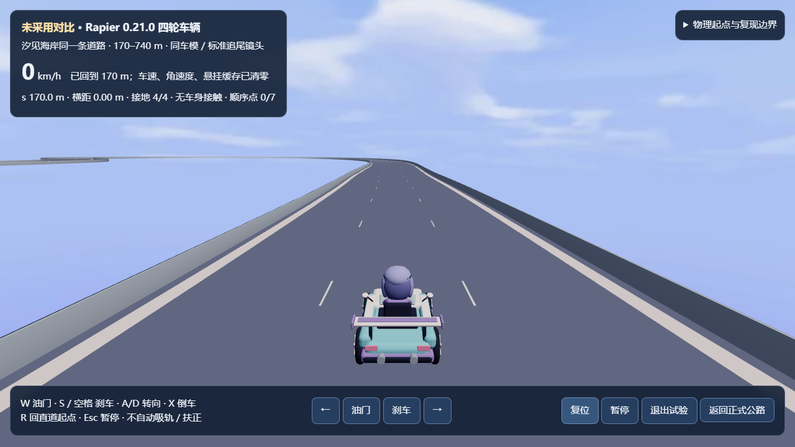

# 当前片段品质：公路默认与 Rapier 旁置试驾

`/` 默认进入公路模式，`/road` 保留兼容地址，菜单可返回 `/legacy` 街机模式。公路进度沿用 `road-v2`，不迁移或删除旧记录。

## 当前交付与差距

[网站 v8 的 `/rapier/`](https://dbvv1-star-rush.pretty-llama-9945.chatgpt.site/rapier/) 已开放汐见海岸 170–740 m 驾驶比较短段，运行源为 `8dddac2`。它不是完整赛车比赛，不接正式 AI、幽灵、成绩或存档；只保道路、路缘、护栏与原车模，未接完整沿途场景。默认入口仍为原公路驾驶，海岸环境音仍为 `off`。

[本轮五入口 headless smoke](quality/smoke/B-STAR-BACKLOG-SMOKE-20261028/20261028T1322Z-8dddac2/report.md) 已通过，实际 renderer 均为 `software`：三个正式入口完成驾驶、暂停、重开及返回；Rapier 完成驾驶、暂停、复位、退出；固定状态入口完成 `ready`。上图复用本作该轮截图，不是前后胜出证据。

目前缺少本单元自制目标图及 GPU 同机位前后对照；驾驶手感、完整同弯与声音未验收。旁置交付不代表画面或手感优于默认，不作默认替换或品质结项。

## 保留的公路基线

此前公路基线的正常根入口，选择训练场竞速、自动试驾，1280×720、高画质、软件 WebGL；F2 诊断开启。图用于道路净空、路肩尺度和天空层次判断，不是人工驾驶或目标硬件性能结果。

## 公路基线已采用

- **低路肩植被**：[固定 CC0 植物源](../assets/landscape/README.md#训练场低植被)只补训练场护栏外的空白，不替换原山体、樱树或碰撞。训练场共增加 46,800 个植物三角面，无新纹理。
- **静态天空**：[Kenney Day 全景](../assets/sky/README.md)去掉天空暗块，保留远距云层；它只是背景，不是环境光。运行 WebP 22,504B，理论 RGBA8 纹理 8MiB，另有解码与驱动成本。低画质仍可绘制，图片失败保原渐变与云；Canvas 和街机保原背景。
- **兼容提示一致**：[Canvas 与 Three 共用公路判定](../race-features.js)，修复 Canvas 弯前漏掉粉色减速提示；不改阈值、箭头形状、物理或镜头。它是中心线建议，不是安全车速或制动距离保证。

## 参照与最大差距

主参照为 [Forza Horizon 5 官方 Emerald Circuit 公路赛展示](https://forza.net/news/forza-horizon-5-road-to-mexico-july-update)。采用依据是本作品正常视角的旧版／候选比较，不冒称同镜头或同预算。

| 最大差距 | 下一步要改善的可见问题 |
|---|---|
| 远山仍是孤立锥体，地表平涂，樱树和建筑轮廓重复 | 做连续地形与层次，不靠放大零散小岩体拼墙 |
| 主车暗部与表面区分仍粗糙 | 保车尾轮廓，增加有感的车漆／轮胎／衣物差异 |
| 路线提示偏小，菜单偏长，小屏辅助字和顶栏操作仍密 | 保驾驶净空与主要信息，不用缩字挤控件 |
| 全场仍超过百万三角形，天空仅为固定白天图片 | 在目标设备核帧时与内存，再决定地形／云层方案 |

此前公路基线已有正常整局与再玩链验证，并补了当时整合树的起步、局部弯前、画质切换、旧模式返回和天空失败路径。连续真人驾驶、混合声音与真实手机操作仍待体验，整体材质和场景完成度尚未达到参照。

## 可重复对照机位

[`coast-chase`、`coast-full-bend`、`academy-depth`](capture.md)分别固定正常驾驶视角、完整弯道与训练场弱纵深观察点；参数由 `capture-presets.mjs` 管理。固定状态工程测试及本轮 `coast-chase&t=0` 软件 smoke 已通过，但尚无这组三机位的 GPU 同状态双拍图；以上历史公路画面与本轮旁置截图均不冒充前后对照。拍摄输入是游戏内部回放，不代替真实驾驶手感验收。
