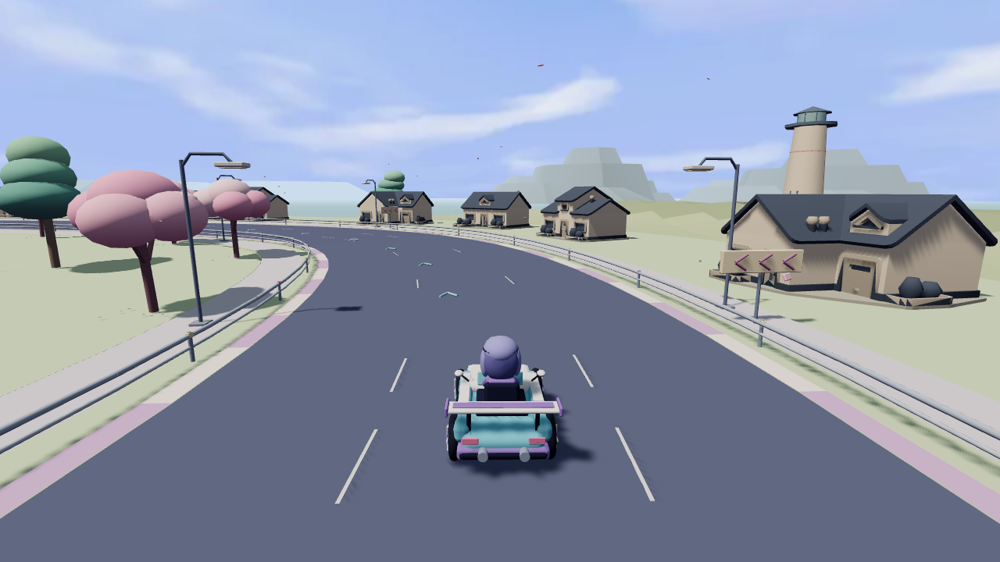
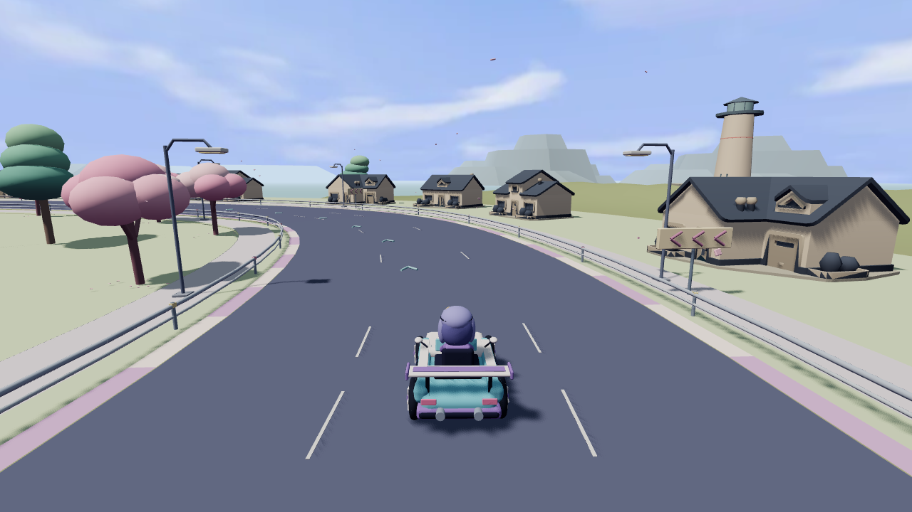
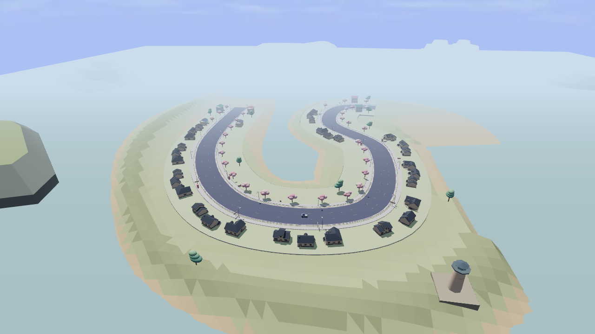
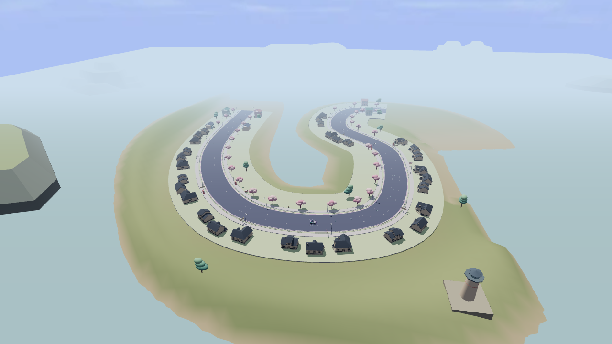
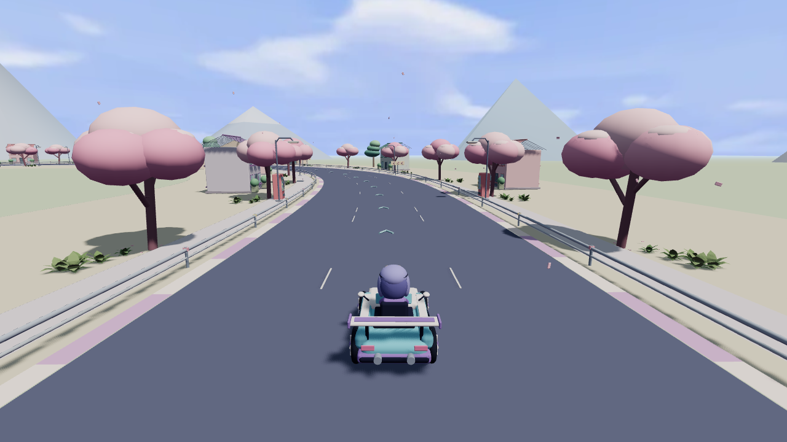

# 固定机位接收与双非作者盲评

## 2026-11-11：与当前默认的静态盲选

**两位非作者都整体偏好整层空间版，未判其整体更差；静态盲选通过，完整整局 smoke 与帧耗仍未通过。** 本次比较不是下文两版空间旁置的旧评审，也没有提高正式评分或内容覆盖。没有重新拍摄、改默认或部署。

前图复用固定 `5962a43` 的[默认捕获原件](https://github.com/dbvv1/Star-Rush-Reborn/tree/2b7f948d7c9a8253e5aeb5159821cee736337318/docs/quality/capture/B-STAR-CAPTURE-REPAIR-20261104)，后图仍为本目录的 `7e87d4c3` 整层原件。与当前 `6d7cb5b` 核对后，前图只取得**固定 Three 捕获的视觉路径等同**资格：捕获器、预设、相机、模拟、赛道、车辆、Three 渲染器、HTML、资产与锁文件未变；无 environment 参数时空间开关为 false，新增街屋／地形分支不执行。scenery 默认分支只增加位置记录，原节点、矩阵、随机调用及顺序保持；新增模块顶层无场景或随机副作用，Canvas 改动不进入 Three。天空加载就绪后仍按同一虚拟时钟推进。当前整层运行源码与 `7e87d4c3` 相同。

三个机位的全部候选捕获 metadata 与默认逐字段相等，包括相机、车辆、seed、tick、t、画质、天空就绪、分辨率和 renderer；PNG 原字节复制后匿名发给两名未参与实现、未见版本或源码的评审，双方不见彼此意见。评审1的 M=默认、R=整层；评审2的 M=整层、R=默认，全部意见返回后揭盲。

| 机位 | 评审1：整层相对默认 | 评审2：整层相对默认 | 共同可见判断 |
|---|---|---|---|
| coast-chase | 持平 | 更好 | 道路与弯向仍清楚；整层中远景更完整，但房屋重复、深色屋顶较抢眼 |
| coast-full-bend | 更好 | 更好 | 陆地、岸线与内湾承接道路，减少默认悬浮底板感；规则底板接缝仍明显 |
| academy-depth | 持平 | 持平 | 未见可辨差异，不计提升 |

两人整体均偏好整层。仍需改善机械排列的小屋、未融合的灯塔底座、空地与远山过渡；没有观察到新增物体实质遮挡驾驶路线。这里是相对静态判断，不是操作、声音、运动稳定性或正式等级验收。

**复用范围止于静态图。** 新旧 bundle 不同，加载、解析与分配成本没有证明等同；不能用旧 dist 或 clean tree 推断新构建身份。默认原捕获和整层捕获都只有固定帧，不是整局；旧 Canvas 启动记录和六路600tick CPU 回归也不补这项。唯一原执行边界核清且设备可用后，仍须冻结拟发布构建、跑完整比赛 smoke 并记帧耗；无明显劣化再换默认与更新网站。硬件 GPU、升档、目标图与人工试听不是前置。

前后图：
- coast-chase：[默认](https://github.com/dbvv1/Star-Rush-Reborn/blob/2b7f948d7c9a8253e5aeb5159821cee736337318/docs/quality/capture/B-STAR-CAPTURE-REPAIR-20261104/coast-chase/coast-chase-software-run1-00000-scene.png)／[整层](../7e87d4c3/coast-chase/coast-chase-run1.png)。
- coast-full-bend：[默认](https://github.com/dbvv1/Star-Rush-Reborn/blob/2b7f948d7c9a8253e5aeb5159821cee736337318/docs/quality/capture/B-STAR-CAPTURE-REPAIR-20261104/coast-full-bend/coast-full-bend-software-run1-00000-scene.png)／[整层](../7e87d4c3/coast-full-bend/coast-full-bend-run1.png)。
- academy-depth：[默认](https://github.com/dbvv1/Star-Rush-Reborn/blob/2b7f948d7c9a8253e5aeb5159821cee736337318/docs/quality/capture/B-STAR-CAPTURE-REPAIR-20261104/academy-depth/academy-depth-software-run1-00000-scene.png)／[整层](../7e87d4c3/academy-depth/academy-depth-run1.png)。

## 2026-11-06：两版空间旁置的历史比较

**接收这批真实图像和回执，保留整层地形版作为下一轮迭代起点；不换默认、不认定品质升档。** 两名非作者均偏好整层版的全弯地表连续性，但三个机位的前后探索性分数均为 **2 → 2**。正式目标与 1–5 锚图仍缺，正式分仍未建立，内容仍 **0/43（0%）**。本轮没有达到“带同机位图的分数变化”完成条件。

上级 README 与 comparison 的 pending 状态保留拍摄交回时点；完成后的评审以本页及两份原始意见为准。

## 证据接收

2026-11-06 收到结果提交 [`dfea2d75`](https://github.com/dbvv1/Star-Rush-Reborn/commit/dfea2d75f37f5041f1c9aa004a112973517fbcb3) 的 41 个文件，其中 12 张 PNG 原字节保留。前版是 `811646e8a69bf9803a1de2218b882ab28b4b1f42`，整层版是 `7e87d4c32d5014612fcb7a8af8bc49d266d7238c`；两版都是既有 `environment=coast-space-v1`，没有把默认场景混入对比。

独立重跑原比较器 exit 0，逐张核 PNG 解码／文件及 RGBA 摘要、双拍一致、跨版车辆／镜头／seed／t／tick／输入／renderer 一致，并另核 manifest 与逐帧 JSON、六条 report／receiver-exit 和构建记录一致。所有图均 `space=true`、`power=false`、`warnings=[]`、`backend=webgl2`，排除候选失败回默认的假通过。两个海岸机位有像素变化，学院控制机位逐字节相同。[接收核验](intake-validation.json)、[重跑比较](comparison-rerun.json) 与[原始 manifest](../manifest.json)保留分开的证据。

- 1280×720，DPR 1，高画质，Mint Comet，road-v2，无幽灵、静音。
- coast-chase / coast-full-bend：seed 73121，t 28，tick 1680；分别 FOV 62 / 58。academy-depth：seed 95276，t 14，tick 840，FOV 62。准确相机与车辆状态见 manifest。
- Chrome for Testing 156.0.8078.4；实际 renderer：`ANGLE (Google, Vulkan 1.3.0 (SwiftShader Device (Subzero) (0x0000C0DE)), SwiftShader driver)`；vendor：`Google Inc. (Google)`。这是软件 WebGL2，不是硬件 GPU。
- 六条拍摄 Node 的真实监督 wait 均 `exitCode=0, signal=null, waited=true`，最后一条于 13:55:24.945 UTC 退出；六个 BrowserServer 均实际退出 0，预览均关闭。时间区间不重叠。**这些收据不证明外层接收 Workflow 或其它登记调用已经退出**；外层状态仍 unknown，不据此清锁、重派或解除隔离。

## 匿名评审与分数

两名未参与实现的评审各自实际查看六张原图副本，不见版本、提交、源码、映射或彼此意见。第一位 A=整层版、B=前版；第二位 X=前版、Y=整层版，映射在两份原始意见完成后才揭盲。第二拍与第一拍字节相同，全部原始双拍仍保留。匿名副本 SHA 与源图一一对应见 [mapping](mapping.json)。

量表仅用于探索：1=原型/灰盒，2=风格基本统一但明显拼装，3=完成度不错的独立游戏；缺目标与锚图，不确证 4/5，不以探索分替代正式目标分。

| 机位 | 评审1 前→后 | 评审2 前→后 | 取低分 前→后 | 相对观察 |
|---|---:|---:|---:|---|
| coast-chase | 2→2 | 2→2 | 2→2 | 两人均仅弱偏整层版；地面较连续，整体差异小 |
| coast-full-bend | 2→2 | 2→2 | 2→2 | 两人明确偏整层版；岸坡条带、三角明暗和网格感减少 |
| academy-depth | 2→2 | 2→2 | 2→2 | 两人肉眼不可区分；独立像素比较另证一致 |

完整原始意见：[评审1](reviewer1.md)、[评审2](reviewer2.md)。两人都建议整层版作为下一轮视觉起点，都不支持据此升级默认。风险仍有平滑后大坡面更空、局部高差线索变弱；不是所有差异都算提升。

## 同机位原图

以下均为 run1；每一张旁边目录有原字节相同的 run2、逐帧 JSON、report 与真实退出收据。未缩放重编码原文件。

### coast-chase

前版 `811646e8`：

整层版 `7e87d4c3`：

### coast-full-bend

前版 `811646e8`：

整层版 `7e87d4c3`：

### academy-depth

前版 `811646e8`：

整层版 `7e87d4c3`：

## 实现差异与下一层

[准确实现差量](implementation-diff.patch)只包含 `coastal-space.js`、对应单测和两份说明。已有岛体 XZ 顶点及拓扑不改，以连续低频缓坡、共享顶点面积加权法线及草／土／岩色域代替原逐三角高度色带。真实海面顶面下的涉水三角、38 m 道路保护区、街屋和原道具支承格冻结；没有改道路、车、镜头、灯光、海面、驾驶模型或声音。两档 bundle／Worker 摘要详见[构建记录](../build-records.json)，未复用前版构建。

两位的共同大差距仍是房屋机械重复、空旷地表、道路地块到岸坡的衔接、孤立灯塔底座与占位式远山。下一轮优先整层组织地形—地块—海岸的近中远连接，并保道路可读性，不以零散新素材或更多房屋数量充进度。目标与锚图补齐后再建立正式分；同机位对比继续保持固定状态。

## 旁置与默认边界

| 门槛 | 前版 811646e8 的既有证据 | 整层版 7e87d4c3 本次证据 |
|---|---|---|
| 默认正常菜单开局 ≥600 物理 tick | Canvas2D 859 tick、无应用错误 | 本次未覆盖 |
| 空间旁置正常菜单开局 ≥600 物理 tick | Canvas2D 1824 tick、无应用错误 | 只验固定拍摄模式，不冒充正常菜单门槛 |
| 轮胎旁置正常菜单开局 ≥600 物理 tick | Canvas2D 859 tick、无应用错误 | 本次未覆盖 |
| 空间＋轮胎正常菜单开局 ≥600 物理 tick | Canvas2D 1821 tick、无应用错误 | 本次未覆盖 |

前版收据见[四路记录](../../../street-side-20261106/browser-gates.json)。上表保留11-06实测范围，候选不能引用前版收据声称自己重跑了四路正常菜单；当时只接收图与评审。

**11-11采用决定：** 按[当前游戏细则§6第3条](https://github.com/dbvv1/a1dbv/blob/af8596c000a1936fa06c92767268afdec31350bf/docs/collaboration/game-taskbook.md#6-作品案例)，表现层功能合入采用真实加载／规定tick／错误与回退证据，和本轮测试／构建，不再额外等待四路正常菜单重拍。整层代码接入原开关后，运行源码与本包`7e87d4c3`逐文件等同，road bundle摘要相同；现有实际拍摄推进2994／1314物理tick、无应用错误，相同默认源859tick的Canvas记录与未改回退路径复用，六路600tick的CPU回归重新通过。新构建正常菜单四路、真实故障注入和完整整局未重测，不冒充通过。

当前默认同机位双非作者盲选、完整整局smoke和帧耗仍须补齐才换默认及更新网站；正式锚图、升档、硬件GPU和人工试听不是前置。原外层退出未知、拍摄槽隔离和历史评分保持。
