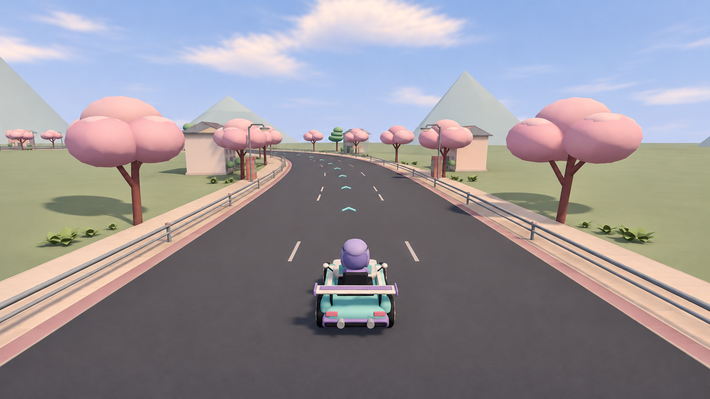
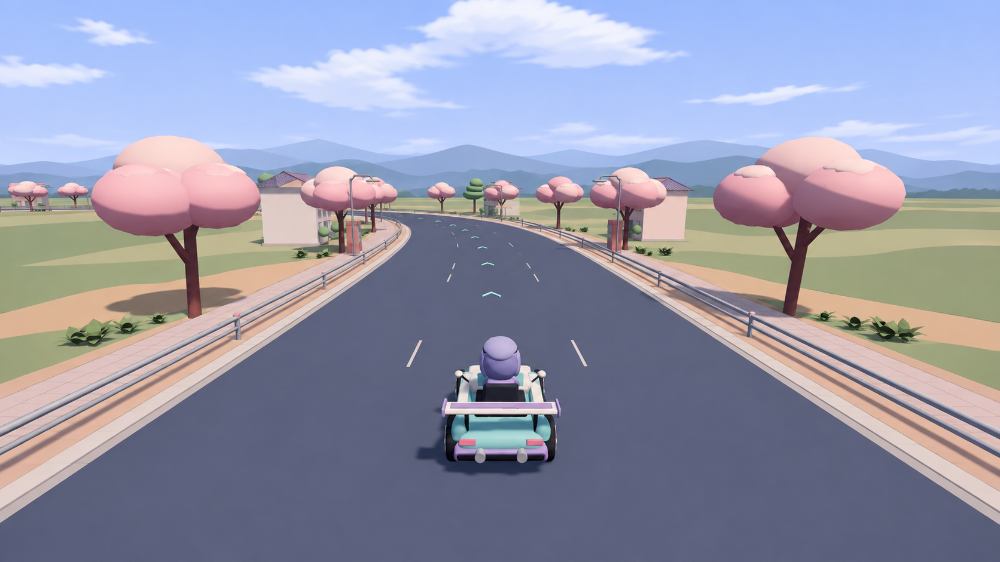

# Academy-depth target alternatives

These are generated paint-over design references, not engine captures or score evidence. The source is the project’s own [archived academy-depth image](../../capture/B-STAR-QUALITY-CAPTURE-20261106/7e87d4c3/academy-depth/academy-depth-run1.png): 1280×720, seed95276, t14, tick840, FOV62, SwiftShader software WebGL2. No commercial image was used. Exact prompts, dimensions and hashes are in [provenance.json](provenance.json). Original generated PNG bytes are retained, at 1672×941, without resizing.

## Independent selection

A nonauthor reviewer saw the source and both actual images without code or author rationale and selected **B** for a conservative whole-scene material/lighting direction. B broadly preserves the central kart, left bend, rails, trees/houses and triangular mountain outlines. Use its restrained dark road, warm pale shoulder, muted green ground and softer light/shadow separation. This renderer uses Toon/Lambert and vertex colors; the image’s apparent surface response is not a claim that PBR roughness maps exist or should be added.

A changes isolated mountains into continuous distant ridges and introduces broad field/earth bands. Keep it as an alternate spatial direction, not the chosen layout-preserving target and not authority to alter the track.

## Actual drift and implementation limits

Both re-draw details. B changes shoulder width/joints, lane-dash density, cyan arrows, tree/building details and largely removes falling petals. Do not reproduce those layout/content changes. Preserve actual game camera, kart, collision geometry, road/markings, object positions and particles. Mountains and empty ground remain unresolved; B is not a completed-quality endpoint or calibrated 3/5 anchor.

When this layer is eligible after the current coast priority, apply the material/value family to the existing whole environment, then use the original fixed state for real before/after captures and independent assessment. This document does not start or claim a capture, clear the unknown original slot, change defaults or deploy a site. Academy remains the unchanged control in current coast comparisons.

No measured score or 0/43 content-coverage change. Star’s active target remains coast-full-bend 2→3; these academy references fill a missing named-camera design input, not a second runtime workstream.
