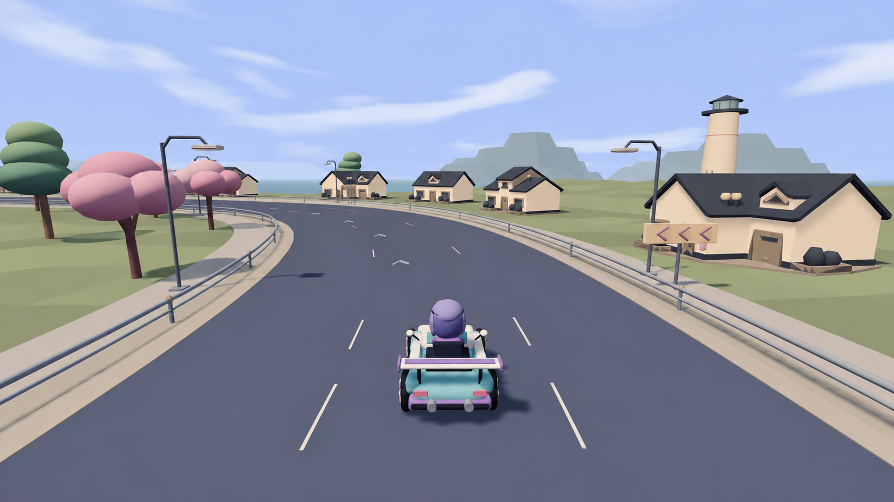
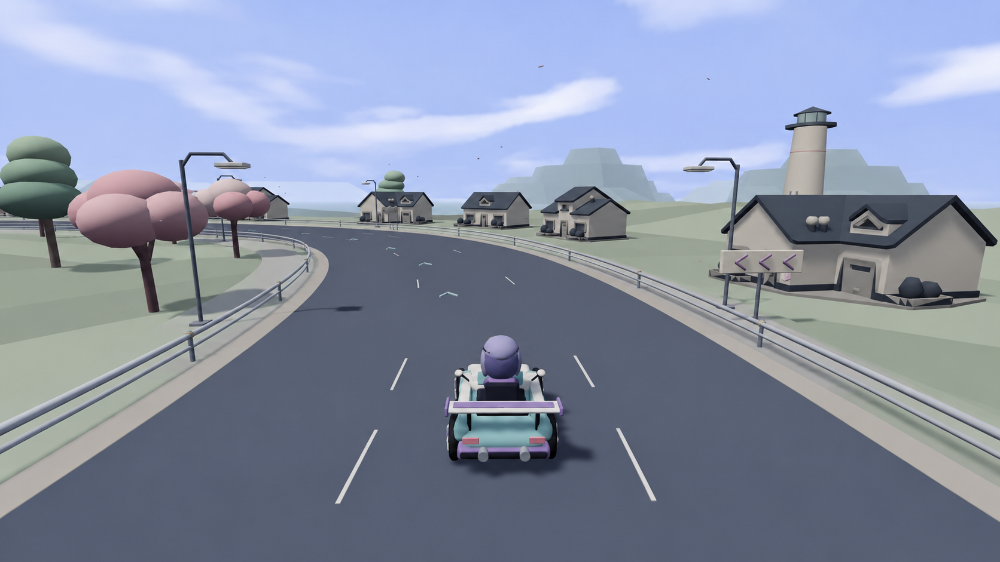

# coast-chase 生成材料参考

两张图由本作已归档的 coast-chase 截图经内置图像生成工具制作；原始 prompt、源图路径和 SHA-256 见 [manifest.json](manifest.json)。保留生成原件，不缩放或重绘。目标图为 1672×941，源截图为 1280×720，均已解码核实；不是新游戏截图、GPU 出图或严格像素对照。

## 非作者选择：A

原非作者实际查看源图与 A/B 后选 **A，仅作材料统一参考**：沙灰路肩、浅暖墙面与灰绿地表对深灰路面分组清楚，并延续 full-bend 已选 B 的材料体系。B 偏冷灰，分离较弱。接收时再次查看源图和两原件，复核文件 hash；未重新生成或重复上传。

## 漂移与采用边界

两图保留追尾构图、主要弯道、房屋序列、灯塔与主车占屏关系，但车体／人物细节、屋檐窗框、树冠轮廓、虚线／箭头、阴影和局部道路边缘都有生成漂移。A 还加强墙面暖光与树冠粉色，不照搬这些变化，不把 prompt 中“EXACT”当达成证明。材料参考补足近景路肩、墙面与出口可读性，机械重复仍未解决。

采用时保留真实几何、相机、标线、玩法和既有资源。真实同机位硬件 GPU 验收需看：暖肩不吞标线、墙面不发白、出口易读、阴影无条纹。仍须完整 smoke 和非作者盲评；prompt 的 3/5 是意图而非游戏分数。Star 2→2、内容 0/43 不变。本次仅接收参考文件，不改运行时、master、网站或原拍摄槽状态。
